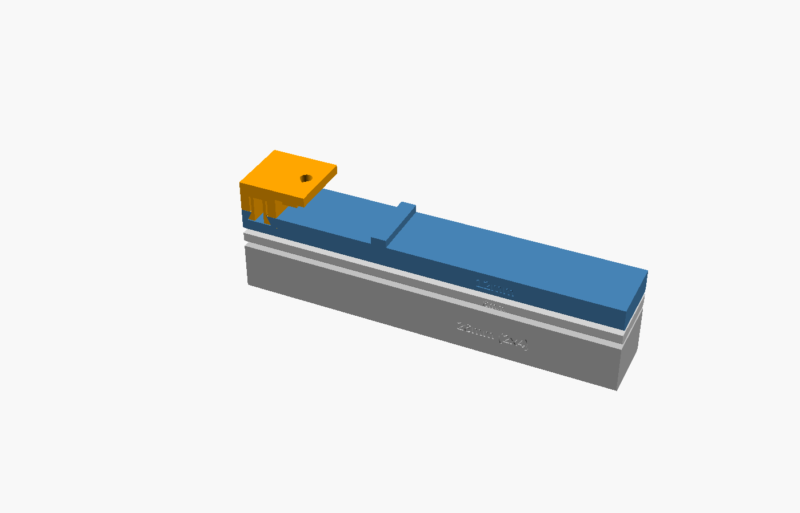

# guide-rail-supports

3D-printed supports for your track saw guide rail. They hold the rail level when you
work with narrow stock, such as cross-cutting narrow boards or ripping thin strips.

The current design is a parametric OpenSCAD model built for the **Makita 183 mm guide rail**
(see [`docs/makita-rail-profile.jpg`](docs/makita-rail-profile.jpg) for the extrusion drawing).



## Design overview

- **Bottom base**: a full-width block, as thick as your workpiece (`base_support_height`).
  It stops 4 mm short of the cutting edge to keep clear of the blade and splinter guard.
  A key on top registers in the rail's underside channel.
- **Top bridge**: clamps through the rail's top T-slot with a drop-in M6 T-bolt. Its post
  fills the side wing and stops 0.2 mm from the rail's outer edge. It joins the base with a
  blind sliding dovetail that **snaps into place**: the tail is split into two springy
  halves with small detent bumps that click into grooves just inside the slot mouth.
  The bumps stay slightly compressed when seated, which pushes the tail against the
  slot's sloped sides and takes out the play.
- **Stackable shim kit** (1, 2, 3, 6 and 26 mm): shims attach under the base with either
  magnets or sliding dovetails (see below). The 12 mm base plus the 26 mm shim gives
  38 mm, the thickness of a 2x4. Each shim has its thickness engraved on it.
- **Support-free printing**: the base and bridge print on their rear faces with teardrop
  holes, and the dovetail tail's rear end is cut back at 45°. The shims print flat.

## Shim connection

Set `shim_connection` to `"magnet"` (default) or `"dovetail"`.

### Magnets

Disc magnets sit at three points along each part (`connector_inset` from each end, plus
the middle). Set the size to match the magnets you have:

| Parameter          | Meaning                                                           |
|--------------------|-------------------------------------------------------------------|
| `magnet_d`         | Diameter of the magnets in the base and thicker shims            |
| `magnet_h`         | Thickness of those magnets                                        |
| `thin_magnet_d`    | Diameter of the magnets that go through thin shims               |
| `magnet_fit`       | Added to hole diameter: about 0.1 for a press fit, 0.3 to glue in |
| `magnet_recess`    | Pocket is this much deeper than the magnet                        |
| `magnet_min_floor` | Least plastic left under a pocket                                 |

Each shim gets the most magnets its thickness allows. Pocket depth is
`magnet_h + magnet_recess`:

- **Room for two pockets** (at least 2 × pocket depth + `magnet_min_floor`): one magnet in
  each face.
- **Room for one pocket**: one magnet in the top face. It holds the shim below through the
  thin floor.
- **Thinner**: a through-hole. Fill it with magnets as thick as the shim (for example one
  10×1 mm magnet in the 1 mm shim) and glue them in.

With the defaults (10×2 mm magnets), the 6 mm and 26 mm shims get two pockets, the 3 mm
shim gets one, and the 1 mm and 2 mm shims get through-holes.

**Polarity:** put every magnet in with the **same pole facing down**. Magnets lined up
the same way always attract, so the shims stack in any order. Mark one pole of your
magnets before you start.

### Dovetails

Each shim has three sliding dovetails on top that slide into slots under the base or the
shim above, from the front. The dovetails are wider, shallower and looser than in the
first version, and the clearance is now measured square to each face. The tail root has
a fillet, and the slot mouth has a matching chamfer to allow for first-layer squish.
Shims too thin to fit a slot with a solid roof above it (1, 2 and 3 mm with the defaults)
can only go at the bottom of a stack.

## Usage

Open `rail-support.scad` in [OpenSCAD](https://openscad.org/) and set `part_to_render`:

| Value              | Output                                                      |
|--------------------|-------------------------------------------------------------|
| `print_plate`      | Every part laid out for printing (the default)              |
| `assembly_preview` | Parts shown assembled, with the `preview_shims` stack below |
| `bottom_base`      | Base only                                                   |
| `top_bridge`       | Bridge only                                                 |
| `shim`             | One shim, `single_shim_h` thick                             |

From the command line:

```bash
openscad -o print_plate.3mf -D 'part_to_render="print_plate"' -D 'shim_connection="magnet"' rail-support.scad
```

The full print plate is about 200 × 290 mm. Use **Split → To Objects** in your slicer and
rearrange the parts, or spread them over more than one plate.

### Tuning the bridge joint

| Parameter      | Effect                                                                 |
|----------------|------------------------------------------------------------------------|
| `dt_clearance` | Gap square to each dovetail face                                       |
| `dt_bump_h`    | Detent bump height: higher means a firmer click                        |
| `dt_preload`   | How much the bump stays compressed when seated: higher means less play |
| `dt_flex_wall` | Thickness of the springy halves: thinner means a softer snap           |
| `dt_flex_len`  | How far the split runs into the post: longer means a softer snap       |
| `dt_snap`      | Set to `false` for a plain dovetail                                    |

Other key parameters:

- `base_support_height`: workpiece thickness
- `side_wing_w`: width of the wing that carries the dovetail and post (20 mm)
- `tolerance`: sliding fit of the underside key and top registration nub
